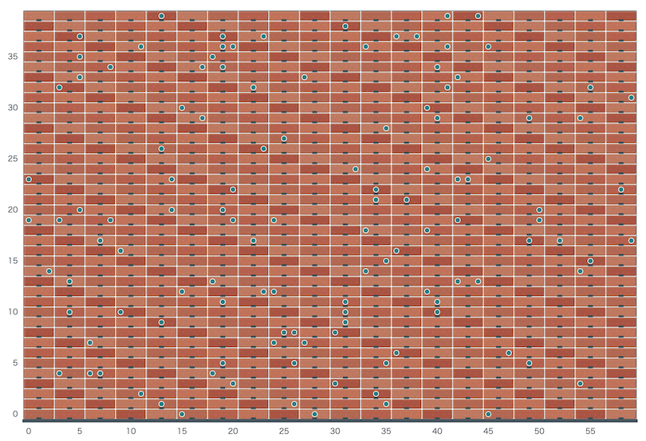

# AtCoder Heuristic Contest 071

[TOC]

## 問題概要

- https://atcoder.jp/contests/ahc071
- 高さHマス、幅Wマスの壁があり、K個の異なるマスに穴が空いている
- 壁の最下段の下は床になっており、レンガを積み上げることで、すべての穴の空いたマスを覆いたい
- レンガは、高さが1マスだが、幅が1、3、5、7、9マスの5種類あり、それぞれコストが異なる
- レンガを積むときは、他のレンガと重ならず、壁からはみ出ずに、レンガの中央部分を支えるように積む必要がある
- すべての穴を覆えるような、できるだけコストが最小になるようなレンガの積み方を求めよ

## 時間

- 4 時間

## 個人的メモ

### 「レンガの代金は、幅が大きいほど高いとは限らない」

- 問題文の入力の制約部分に書かれているが、幅ごとに独立に代金が決まるので、同じ場合や逆転する可能性がある
  - 幅1は5
  - 幅3は5〜10
  - 幅5は9〜14
  - 幅7は13〜18
  - 幅9は17〜22
- seed\=19とかは幅5(代金14)より幅7(代金13)の方が代金が安い

### レンガの支え

- レンガを配置する時、レンガの中央部分の下のマスに他のレンガがある必要がある
- これは、「レンガを置いたら中央部分の下のマスに穴が空く」とも考えられる
- レンガを任意のところに置きたい場合、下側に制約条件が生まれるので、壁の上側から下に向かってレンガの配置を考えていくと考えやすい
- (最悪、幅1を床まで伸ばせばvalidな解が作れるので、途中のところにレンガを置くこと自体は考えやすい)
  - 幅1を直下に伸ばして支えるよりも、幅3を斜めに繋いで支えるほうが少ない個数で抑えられる可能性があるため、そういう配置を見つけられる方法を考える必要があった

### アプローチ

- 大きな方針は同じでも細かいところでは結構いろんな方針があった模様

#### 上から下に配置を決める

- 「レンガの支え」での考察から、壁の上の行を先に決めると、その1つ下の行で支えるべきマスが決まるので、そのマスと穴マスを塞ぐようなレンガ配置を決めていく
- 各行だけ考えると、穴のマスと上から要求される支えるマスの集合が与えられるので、下の行にかかるコストを無視すると、左から右へのDPで解ける
  - dp\[x\] := 左からxマスまでを処理するのにかかる最小コスト
  - これをやると147万点前後？
- 未来のコストの推定値を考える
  - 下の行に関する追加コストの推定値的なのをいれて計算するとかなり良くなるっぽい
  - 本の穴を利用した、位置ごとの追加コストを事前にDPで求める
    - turnejaさんの評価関数
      - https://x.com/wata_orz/status/2099139067095199785
      - (解法見に行ったらめちゃくちゃ短い)
      - 支えるマスについて、「そのマスを塞ぐために必要な追加コスト」的なのを考えて、評価に加えるみたい
        - 近くの穴といっしょにレンガを配置できたりする場合は追加コストは小さく済む可能性がある
- ビームサーチ化
  - 上記のDPでのどれかのレンガを置くか開けておくかの選択肢をビームサーチにする感じ
    - 各位置で複数状態を残すイメージ
      - 1列ずつではなく、1マスずつ的な感じ
  - 単純に、評価関数での累積コストに「支点を幅1レンガで支えた場合のコスト(5\*y)」とか加えるだけでも158万点前後でてそう
- その他
  - 右から左の方向も考える(左から右のみだとレンガの起き方に偏りがでやすい？)
  - 支点は近いと1つのレンガでまとめて覆える可能性があるのを評価に入れる
  - 1マスずつというより、必要マスから列挙する
  - 初期解にして、余った時間を局所改善する

#### 局所改善系

- 幅3以上のレンガの位置を焼きなまし
  - 幅1は、宙に浮いてしまうレンガが出た場合のみ支えるために使うとして、残りの幅3以上のレンガの配置をいろいろ変えて試す
  - 近傍は、追加、削除、置換、ずらす、あたり
    - (自分は、置換(追加したときに重なるレンガを消したり置き直す感じの)近傍が入れられてなくてスコアが伸ばせてなかった、、、)
- 行をDPで作り直す局所改善
  - https://x.com/kaliafluorido/status/2099140865671536701
  - ある状態に対して、上下からの制約と今の行の制約などを入れたDPで作り直す
  - 1行だけでなく、複数行(下部分)などまとめてなども？
- 各行の区切り方を状態にした焼きなまし
  - https://topcoder-tomerun.hatenablog.jp/entry/2026/09/20/160029
  - 各行を区間に分割して、必要なやつだけ残すようにすれば完成配置が決まるので、連続区間内を作り直す局所改善ができる
    - 変更部分の下の配置の再計算は必要(枝刈りなどできる)
- 穴を処理する順番を局所改善
  - https://x.com/ei1333/status/2099137461536587940
  - その穴を塞ぐためのレンガを下から支える配置をDPで求める

#### その他

- 縦方向の帯をまとめて作り直す(範囲と配置パターンを制限して作り直す、部分破壊再構築っぽい感じ？)
- 下から上にビムサ

## その他

### お絵かき

- https://x.com/prd_xxx/status/2099146927787163868

## 解説

(50位まで&発言を見つけられた方のみ)

- [解説](https://atcoder.jp/contests/ahc071/editorial)

- [writer解](https://img.atcoder.jp/ahc071/writer_solution_ja.html)
  - https://x.com/wata_orz/status/2099138607638511729
  - https://x.com/wata_orz/status/2099139067095199785
  - https://x.com/wata_orz/status/2099140759626871137

- [rhooさん](https://x.com/rho__o/status/2099137576959676798)
  - https://x.com/rho__o/status/2099141827811271108
- [nikajさん](https://x.com/nikaitsu/status/2099139127920710107)
- [asi1024さん](https://x.com/asi1024/status/2099140487492075524)
  - https://x.com/asi1024/status/2099476915056992340
- [mtsdさん](https://x.com/soiya_ksk/status/2099138111313944948)
- [terry_u16さん](https://x.com/terry_u16/status/2099138726916223418)
  - https://x.com/terry_u16/status/2099139616888766643
  - https://x.com/terry_u16/status/2099141951123829132
  - https://x.com/terry_u16/status/2099142340384526605
  - https://x.com/terry_u16/status/2099142827297087701
  - https://x.com/terry_u16/status/2099146757364183134
  - https://x.com/terry_u16/status/2099148518414057529
- [takumi152さん](https://x.com/takumi152/status/2099138059493425192)
- [kariaaさん](https://x.com/kaliafluorido/status/2099140865671536701)
- [tomerunさん](https://x.com/tomerun/status/2099138218180698341)
  - https://topcoder-tomerun.hatenablog.jp/entry/2026/09/20/160029
- [risujirohさん](https://x.com/risujiroh/status/2099137558596956310)
  - https://x.com/risujiroh/status/2099161711156814195
- [Koi51さん](https://x.com/Koi1583/status/2099138364398330071)
- [tempura0224さん](https://x.com/tempuracpp/status/2099164629322940649)
- [ei13333さん](https://x.com/ei1333/status/2099137461536587940)
  - https://x.com/ei1333/status/2099137632227983865
  - https://x.com/ei1333/status/2099138049737371956
- [Shun_PIさん](https://x.com/Shun___PI/status/2099136464856748282)
  - https://x.com/Shun___PI/status/2099137680257044576
  - https://x.com/Shun___PI/status/2099138699502276663
- [Jinapettoさん](https://x.com/Jinapetto/status/2099138858210513000)
- [itigoさん](https://x.com/itigo_purokonn/status/2099136948342591762)
  - https://x.com/itigo_purokonn/status/2099137878291050801
  - https://x.com/itigo_purokonn/status/2099139220128633138
  - https://x.com/itigo_purokonn/status/2099139715090063803
- [semiexpさん](https://x.com/semiexp/status/2099137465445679267)
- [MathGorillaさん](https://x.com/MathGorilla_cp/status/2099139942907785659)
- [sky58さん](https://x.com/skyaozora/status/2099136421823193499)
  - https://x.com/skyaozora/status/2099137408378011671
  - https://x.com/skyaozora/status/2101078785823260748
- [rabotさん](https://x.com/tanaka_a8/status/2099491980195889616)
- [plcherrimさん](https://x.com/plcherrim/status/2099139259777327170)
  - https://x.com/plcherrim/status/2099140230658113726
  - https://x.com/plcherrim/status/2099141340831596667
  - https://x.com/plcherrim/status/2099142526859141561
- [Kiri8128さん](https://x.com/kiri8128/status/2099140377538363646)
  - https://x.com/kiri8128/status/2099141190495207620
  - https://x.com/kiri8128/status/2099147570866250159
  - https://x.com/kiri8128/status/2099147904636350644
- [k1suxuさん](https://x.com/k1suxu/status/2099142295727788507)
- [toku4388さん](https://x.com/toku4388/status/2099147691397931403)
- [titan23さん](https://x.com/titan_230/status/2099136338771792187)
- [kenchoさん](https://x.com/border_of_ymg/status/2099138012596908382)
  - https://x.com/border_of_ymg/status/2099142747718660242
  - https://x.com/border_of_ymg/status/2099143302893433198
- [shingo0909さん](https://x.com/shingo_kyopro/status/2099141629542310201)
- [Moegiさん](https://x.com/mih28731325/status/2099137657700012087)
  - https://x.com/mih28731325/status/2099140204682781163
- [occhanさん](https://x.com/occhan_code/status/2099139190743273644)
- [FplusFplusFさん](https://x.com/FplusFplusF____/status/2099139682194038883)
  - https://x.com/FplusFplusF____/status/2099140920642036013
  - https://x.com/FplusFplusF____/status/2099322418691281053
  - https://x.com/FplusFplusF____/status/2099500583636066365
- [toomerさん](https://x.com/toomerhs/status/2099137902152454623)
- [notさん](https://x.com/not_522/status/2099139553764557209)
  - https://x.com/not_522/status/2099140686331469979
- [chokudai社長](https://x.com/chokudai/status/2099073620777869681)
  - https://x.com/chokudai/status/2099139837894996003
  - https://x.com/chokudai/status/2099331830885580876
  - https://x.com/chokudai/status/2099346159089410367

## Links

- [twitter hashtag AHC071](https://x.com/hashtag/AHC071)
- [twitter search AHC071](https://x.com/search?q=AHC071)
- [あとこちゃん観戦記](https://chokudai.github.io/atoco-cp/post/2026-09-13-ahc071/)
