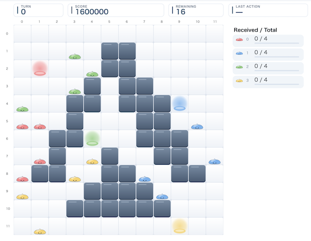

# ALGO ARTISプログラミングコンテスト2026長月(AtCoder Heuristic Contest 072)

[TOC]

## 問題概要

- https://atcoder.jp/contests/ahc072
- N\*N マスの盤面上に、K色のスライムが何匹かいる
  - スライムの他には、壁のマス、スライムの巣(K色)のマスがある
- すべてのスライムを対応する色の巣まで帰したい(帰巣)
- スライムは、重なって「塔」(最大8匹まで)を作ることができ、一緒に動かすことができる
  - 異なる色のスライムでもよい
- 動かすときには以下の「宙返りジャンプ」操作のみが行える
  - ある塔(1匹も含む)のあるマスを選び、その塔のの下に残す匹数(0匹も含む)、方向、飛距離を決めて、塔の上部のスライムをジャンプさせる
    - 下に残す匹数が多いほど、遠くにジャンプできる
  - ジャンプ後、着地地点では、ジャンプ前の順序を上下に反転させてから着地地点にある塔の上に載せる
  - ただし、ジャンプに関する制約があり、その制約を満たすジャンプのみ可能
- できるだけ少ない操作回数ですべてのスライムを帰巣させる操作列を求めよ

## 時間

- 239時間50分
  - 開始が少し遅れた

## 個人的メモ

### アプローチ

#### 1匹ずつ運搬 / 同色まとめて運搬

- とりあえず最初に思いつくのは1匹ずつ帰巣させるアプローチ
- 1匹ずつ帰巣させる場合は、他のスライムを無視して移動を考えればよいので、BFSで求められる
- また、発展として、同色のスライムはゴールが同じなので、途中で合流しながらまとめて移動すると効率が良いので、ゴールからBFS木を作って遠いスライムから順に近づける操作で求めるなどできる
  - とりあえず7匹以下であれば、他のスライムがあっても移動できる
- しかし、validな解は作れるが、異色スライムで塔を作ったり、ジャンプを組み合わせたり、など、移動ルールを人手で考えて発展させていくのは結構厳しいので、探索を考える必要がある

#### スライムの経路引き直し(LNS)で局所改善

- 他のスライムは固定して、あるスライムの経路を作り直すことを考える
- 追加手数で考えると、その場で待つなら0手、既存の塔の動きに乗れれば0手で移動、そうでなければ単独で動くので1手で移動、ができるので、ターン・マス・塔での位置を状態にして時空間01BFSで考えることができる
  - ただし、塔の高さの制限を超えたり、他の移動を邪魔したり、ジャンプが変わる、など、気をつけて処理しないとinvalidになる動きがあるので注意
    - 細かいところはいろいろ詰めるところがあって、単純にinvalidな動きに対処しないと再構築に失敗しやすかったりと、実際の動きなどを見ながら改善していく必要があるかも、、
  - 対象の選び方、部分区間を対象にする、ジャンプ順の入れ替え、など、いろいろ近傍をいじれる
  - ジャンプの土台などにしていた場合、取り除いたことで足りなくなってしまう場合は、作り直しによってどれかが埋める必要があるので、「予約」しておくとよい
- これをベースに、複数スライムを取り除いて経路引き直しする近傍を考えると、焼きなましなど局所改善ができる
- 初期解
  - 同色を優先して(少ない色から)塔にして移動するものを初期解にしていた人が多そう？
    - この時点では操作回数がそこまで少ないわけではない
  - 局所探索も入れたり、貪欲や局所探索ではなくビムサで初期解構築も
  - 初期解は結構重要かもしれず、後半のLNSでも大きな経路変更はされにくいので、おおよその経路がよい(!=操作回数が少ない)初期解を作る必要があったかも
  - また、どちらかというと初期解を頑張るよりも局所改善に時間をかけたほうが良さそう
- その他
  - 高速化、枝刈り
  - https://img.atcoder.jp/ahc072/editorial.html#13.0
  - 秒数を伸ばして2秒の場合との差分から近傍などを検討
  - 巣側から逆順に調べると、同色のスライム候補をまとめて調べられる
    - 巣から湧き出し
  - 012BFS
    - https://x.com/fuppy_kyopro/status/2107051312512995746
    - 塔の中間を別方向に逃がす操作をコスト2(追加手数2手)で考慮しているみたい

#### 1手ずつビムサ

- https://x.com/titan_230/status/2107048460163932351
  - https://x.com/titan_230/status/2107551525195469251
- https://x.com/MathGorilla_cp/status/2107127135911723464
- 1手ずつ進めるビムサ(+局所改善)
- 評価関数
  - 巣までの残り距離ではなく、具体的な帰巣までの経路の木を作っておくと、各位置でのスライムの動きの集計ができる(通過匹数など)
  - 動かせるスライムやジャンプ先候補が大量に出てしまって、あっちこっちバラバラに動かす感じの動きになってしまう可能性があるが、直前ターンからの近さを考慮(遠ければペナルティ。ただし今のターンだけ反映)することで抑えることができる(解説放送)

### その他

#### MAPF

- Multi-Agent Path Finding
- https://kei18.github.io/note/posts/mapf-tutorial/
- https://en.wikipedia.org/wiki/Multi-agent_pathfinding

#### AI方針の把握

- スライドを作らせる
  - https://x.com/titan_230/status/2107048906609893664

#### seed\=0のビジュアライザ出力画像の共有

- https://x.com/search?q=%23AHC072%20%23visualizer&f=live
- 43点が最小そう

#### お絵かき

- https://x.com/Rinoprogram/status/2107458964657193342

## 解説

(50位まで&発言を見つけられた方のみ)

- [AHCラジオ(解説放送)](https://www.youtube.com/watch?v=rWT1uRLPXBs)
  - [解説スライド](https://img.atcoder.jp/ahc072/editorial.html)
- [解説](https://atcoder.jp/contests/ahc072/editorial)

- https://www.algo-artis.com/news/261014/

- [mech_39さん](https://x.com/fuwaorune/status/2107051406901526955)
  - https://www.youtube.com/watch?v=rza9mEkY12k
  - https://x.com/fuwaorune/status/2107051860045742395
  - https://x.com/fuwaorune/status/2107052662722273429
  - https://x.com/fuwaorune/status/2107055501204975743
  - https://x.com/fuwaorune/status/2107056698091610159
  - https://x.com/fuwaorune/status/2107162209885552681
  - https://x.com/fuwaorune/status/2107163060939223082
- [c7c7さん](https://x.com/C7C7LL/status/2107066420655976505)
- [melo25さん](https://x.com/melo_atc/status/2107052477417984436)
- [asi1024さん](https://x.com/asi1024/status/2107058821176934870)
  - https://x.com/asi1024/status/2107070034036330743
  - https://x.com/asi1024/status/2107078785371922574
- [bayashikoさん](https://x.com/bayashiko_kpr/status/2107049329974497360)
  - https://x.com/bayashiko_kpr/status/2107050147142353329
  - https://x.com/bayashiko_kpr/status/2107051478896832859
  - https://x.com/bayashiko_kpr/status/2107055729450570186
  - https://x.com/bayashiko_kpr/status/2107090869157556362
- [k1suxuさん](https://x.com/k1suxu/status/2107053798862831956)
- [Piiiiiさん](https://x.com/AcPiiiii/status/2107051007259857317)
- [titan23さん](https://x.com/titan_230/status/2107048460163932351)
  - https://x.com/titan_230/status/2107049772586791305
  - https://x.com/titan_230/status/2107055035217752234
  - https://x.com/titan_230/status/2107053513759207649
  - https://x.com/titan_230/status/2107108597838807085
  - https://x.com/titan_230/status/2107112280668393751
  - https://x.com/titan_230/status/2107113104978940273
  - https://x.com/titan_230/status/2107551525195469251
- [Moegiさん](https://x.com/mih28731325/status/2107050267825066093)
  - https://x.com/mih28731325/status/2107051669674758608
  - https://x.com/mih28731325/status/2107053745809055897
  - https://x.com/mih28731325/status/2107063762431975882
  - https://x.com/mih28731325/status/2107064033639911907
  - https://x.com/mih28731325/status/2107074105992483285
- [Yuuki2028さん](https://x.com/Yuuki14202028/status/2107058491462689058)
  - https://x.com/Yuuki14202028/status/2107063026876887523
  - https://x.com/Yuuki14202028/status/2107066375823122786
  - https://x.com/Yuuki14202028/status/2107074104646066678
- [syndromeさん](https://x.com/syndro_6/status/2107064406706442733)
- [montplusaさん](https://x.com/montplusa/status/2103462248077509026)
  - https://x.com/montplusa/status/2107052800782000331
  - https://x.com/montplusa/status/2107057979665301998
  - https://x.com/montplusa/status/2107403043667124240
  - https://x.com/montplusa/status/2107404298531508321
- [hitonanodeさん](https://x.com/rsat__m/status/2107067751911366854)
- [Ang107さん](https://x.com/Ang_kyopro/status/2107048194383413423)
  - https://x.com/Ang_kyopro/status/2107048618842845648
  - https://x.com/Ang_kyopro/status/2107048964931674115
  - https://x.com/Ang_kyopro/status/2107049981123375523
  - https://x.com/Ang_kyopro/status/2107053120371241374
  - https://x.com/Ang_kyopro/status/2107053456939004096
  - https://x.com/Ang_kyopro/status/2107054386203804126
  - https://x.com/Ang_kyopro/status/2107063944091410714
- [nikajさん](https://x.com/nikaitsu/status/2103456031799996562)
  - https://x.com/nikaitsu/status/2107050157879763413
- [throughさん](https://x.com/through__TH__/status/2107057218017485109)
  - https://x.com/through__TH__/status/2107314107225665770
- [tsukammoさん](https://x.com/tsukammo/status/2107048990672044104)
  - https://x.com/tsukammo/status/2107050332299931698
  - https://x.com/tsukammo/status/2107054894813516003
  - https://x.com/tsukammo/status/2107055700530909312
- [kariaaさん](https://x.com/kaliafluorido/status/2107049513752170929)
  - https://x.com/kaliafluorido/status/2107056391995425211
- [saharanさん](https://x.com/shr_pc/status/2107179635805167631)
- [satoyukiさん](https://x.com/tomatokiraida52/status/2107049756417823137)
  - https://www.youtube.com/watch?v=iAlH72_qnQE
  - https://x.com/tomatokiraida52/status/2107092247577801039
- [physics0523さん](https://x.com/butsurizuki/status/2107089651211358496)
  - https://x.com/butsurizuki/status/2107091205603672455
  - https://x.com/butsurizuki/status/2107091940516999235
  - https://x.com/butsurizuki/status/2107092845295448131
  - https://x.com/butsurizuki/status/2107095499467846005
  - https://x.com/butsurizuki/status/2107096070476218843
  - https://x.com/butsurizuki/status/2107098128621183410
  - https://x.com/butsurizuki/status/2107104757794103359
  - https://x.com/butsurizuki/status/2107114142226391520
  - https://x.com/butsurizuki/status/2107117830995116225
  - https://x.com/butsurizuki/status/2107118474497798551
  - https://x.com/butsurizuki/status/2107126106348462191
  - https://x.com/butsurizuki/status/2107203444448870802
- [Jinapettoさん](https://x.com/Jinapetto/status/2107051605648638272)
- [moldauさん](https://x.com/moldau205205/status/2107063267978092639)
- [MathGorillaさん](https://x.com/MathGorilla_cp/status/2107127135911723464)
- [Kyo25さん](https://x.com/Kyo25_X/status/2107050038686085287)
  - https://x.com/Kyo25_X/status/2107064881954627892
- [ryomac1さん](https://x.com/ryomac1993/status/2107064694544724285)
  - https://x.com/ryomac1993/status/2107072064821834091
- [fuppy0716さん](https://x.com/fuppy_kyopro/status/2107051312512995746)
  - https://x.com/fuppy_kyopro/status/2107055134455013483
- [WaTeR7さん](https://x.com/Mizuno_0724/status/2107052902284181962)
  - https://x.com/Mizuno_0724/status/2107053752184459463
  - https://x.com/Mizuno_0724/status/2107058288819069268
  - https://water7.net/blog/ahc072-slimes/
- [keroruさん](https://x.com/keroru10/status/2106316578082177494)
  - https://x.com/keroru10/status/2107050212623876404
  - https://x.com/keroru10/status/2107051197064745299
  - https://x.com/keroru10/status/2107056228157599888
  - https://x.com/keroru10/status/2107058147210973556
  - https://x.com/keroru10/status/2107062372137656446
  - https://x.com/keroru10/status/2107064541523955854
  - https://x.com/keroru10/status/2107069503087776210
  - https://x.com/keroru10/status/2107075126730883166
  - https://x.com/keroru10/status/2107084498290786586
  - https://x.com/keroru10/status/2107084780722438486
  - https://x.com/keroru10/status/2107093065035108372
  - https://x.com/keroru10/status/2107121983351882054
  - https://x.com/keroru10/status/2107322980930040244
- [pitPさん](https://x.com/HISHO_NO_KISEKI/status/2107048664493699117)
  - https://x.com/HISHO_NO_KISEKI/status/2107049449361199328
  - https://x.com/HISHO_NO_KISEKI/status/2107050598994792938
  - https://x.com/HISHO_NO_KISEKI/status/2107056687576473876
  - https://x.com/HISHO_NO_KISEKI/status/2107063697063780369
  - https://x.com/HISHO_NO_KISEKI/status/2107096667870961931
- [PrussianBlueさん](https://x.com/prussian_coder/status/2107049881982665145)
  - https://x.com/prussian_coder/status/2107056523990220815
  - https://x.com/prussian_coder/status/2107072251493556633
  - https://x.com/prussian_coder/status/2107304668858900962
- [chun1182さん](https://x.com/carat1182/status/2107108575755853825)
- [maeda3さん](https://x.com/dj_maeda3/status/2107050687976907173)
  - https://x.com/dj_maeda3/status/2107063263414677987
- [Illedanさん](https://x.com/erik_kvanli/status/2107225075737116693)

## Links

- [twitter hashtag AHC072](https://x.com/hashtag/AHC072)
- [twitter search AHC072](https://x.com/search?q=AHC072)
- [あとこちゃん観戦記](https://chokudai.github.io/atoco-cp/post/2026-10-05-ahc072/)
