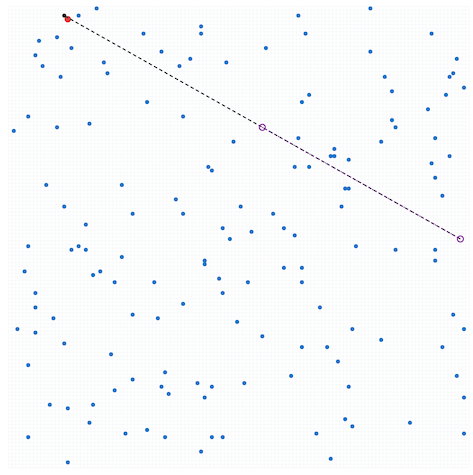

# AtCoder Heuristic Contest 073

[TOC]

## 問題概要

- https://atcoder.jp/contests/ahc073
- N\*N マスの盤面があり、初期位置と、順番に訪れたいM個の目的地が与えられる
- 盤面には、K(\=3)個の魔法陣を設置することができる
- 魔法陣は、ある位置pで指定した魔法陣を使うことで、「その魔法陣から点対称の位置に移動し、使った魔法陣は消え、位置pに魔法陣が置かれる」という「転移」操作が行える
  - 盤面外に移動するような移動は許されない
- 魔法陣を使わない場合は、今いる位置から上下左右に1マス移動する「歩行」操作で移動する
- すべての目的地にできるだけ少ない操作回数で移動するような、魔法陣の初期位置と、目的地へ移動する操作列を求めよ

## 時間

- 4 時間

## 個人的メモ

### 魔法陣が端に寄ると戻しにくい

- 魔法陣は使うと、転移元の方に移動するので、盤面の端のほうに寄ってしまうと、それ以降はかなり扱いにくくなってしまう
  - 端のほうにある魔法陣を中央に寄せようとするには、転移でより端の方に移動するしかないが、そもそも端に寄ってしまうと長い距離は転移できないので、位置はちょっとしか戻せないが、転移でより端にいかなくてはいけない感じでかなり戻しにくい
- なので、魔法陣の位置の管理やその後の動きを考えて動かす必要がありそうに見える

### 逆方向に考える

- この問題は逆方向から考えるとかなり扱いやすくなる、、、
- 訪問順を逆方向に考えると、魔法陣を使った移動が、「転移した両端の中間地点(中点)」に移動するような感じ、として考えることができる
  - また、ゴールからスタートへ探すような感じにして操作もすべて逆にすると、今ある魔法陣が転移先になる、感じになる
- こうすると、転移は、今の魔法陣の位置と任意の点になり、転移後は中点なので、盤面外に出る可能性も考えなくて済む
  - 中点が整数座標になる必要はある
  - 使ってもあまり端に寄らないので使いやすい

### アプローチ

#### 逆方向で貪欲・ビームサーチ

- (解説)
- 逆方向が思いつければ、転移が扱いやすいので、各スタートとゴール地点付近から、「ジャンプ→歩く」「歩く→ジャンプ」とかを考えて、手数が減るものを選ぶ貪欲でもかなりスコアが出るらしい
- 上位はこの方針の方が多かったみたい

#### 順方向で貪欲・ビームサーチ

- 順方向に求めるのでも(結構工夫が必要かもだが)結構スコアは出せてたみたい
  - 魔法陣が中央近くにいるようにしたり、転移であまり大きく変化させないようにする仕組みが大切っぽそう

#### 局所改善

- 魔法陣の順番を状態にする
  - (逆方向を前提として)、各目的地間移動で使う魔法陣と順番を持って、焼きなまし
  - 逆方向だと中点移動的なので、前半の変更での影響が後半へあまり大きく出にくいみたい
    - https://x.com/tempuracpp/status/2111399665640120562
  - https://atcoder.jp/contests/ahc073/editorial/27262
- K個の魔法陣の位置(使う位置)を状態にする
  - https://x.com/montplusa/status/2111404394474565667
  - 魔法陣をその位置にするために転移をすることで、移動手数も減らせるので、それを最適化できる

##### DP

- 例えば、魔法陣が1つで高々1回使う場合は、dp\[i\]\[y\]\[x\] := i番目の目的地のときに魔法陣が(y,x)にある場合の最短操作回数、的な感じを考えると最適化できる

### 同じ魔法陣で連続転移

- ある魔法陣を使って転移した後に、連続して、その位置が移動した魔法陣を使って転移する事もできる
  - (同じ魔法陣を2回使う的な感じ)
  - x\=50にいて、x\=60の魔法陣を使って、x\=70に転移し、続けてx\=50に移った魔法陣を使ってx\=30に転移する、感じ
- 各魔法陣を1回しか使わない感じの制約を入れてしまうと、やや不利になる可能性

### その他

#### 軸は独立で考えられる

- 転移する/しないが固定なら、x軸とy軸は独立に考えられる
  - 同時に考えなくていいので計算量が減らせる可能性がある

#### パリティ

- 転移によって座標の偶奇が変わらないので、スタートとゴールの座標の偶奇が違うなら、必ず1歩は歩行が必要

## 解説

(50位まで&発言を見つけられた方のみ)

- [解説](https://atcoder.jp/contests/ahc073/editorial)

- [writer解](https://x.com/wata_orz/status/2111398421739536659)
  - https://img.atcoder.jp/ahc073/editorial.html

- [hitonanodeさん](https://x.com/rsat__m/status/2111404708028198953)
  - https://www.youtube.com/watch?v=9zGsw2qkYw0
- [Shun_PIさん](https://x.com/Shun___PI/status/2111398459924496810)
- [noimiさん](https://x.com/noimi_kyopro/status/2111396932153409902)
  - https://x.com/noimi_kyopro/status/2111397360865812810
  - https://x.com/noimi_kyopro/status/2111397755537232038
  - https://x.com/noimi_kyopro/status/2111397896994398693
  - https://x.com/noimi_kyopro/status/2111398239421501442
  - https://x.com/noimi_kyopro/status/2111398679596913143
  - https://x.com/noimi_kyopro/status/2111399656198664511
  - https://x.com/noimi_kyopro/status/2111399828307825143
- [physics0523さん](https://x.com/butsurizuki/status/2111405583010328802)
  - https://x.com/butsurizuki/status/2111440873062019205
- [tempura0224さん](https://x.com/tempuracpp/status/2111399665640120562)
  - https://x.com/tempuracpp/status/2111401019569807503
  - https://x.com/tempuracpp/status/2111412176720400401
- [yokozuna57さん](https://x.com/yokozuna_57/status/2111398872899793025)
  - https://x.com/yokozuna_57/status/2111399939976884390
  - https://x.com/yokozuna_57/status/2111400007752688092
- [Piiiiiさん](https://x.com/AcPiiiii/status/2111400233330741630)
- [bresoさん](https://x.com/Carbon_so6/status/2111398285999243416)
  - https://x.com/Carbon_so6/status/2111399034384707887
  - https://x.com/Carbon_so6/status/2111406411637051617
  - https://www.youtube.com/watch?v=L2VLiUtCVzc
- [riantkbさん](https://x.com/rian_tkb/status/2111399821508853990)
- [montplusaさん](https://x.com/montplusa/status/2111402658229850202)
  - https://x.com/montplusa/status/2111404394474565667
- [toamさん](https://x.com/torii_kyopro/status/2111398084525879699)
  - https://x.com/torii_kyopro/status/2111398487032271318
  - https://x.com/torii_kyopro/status/2111399035957592323
  - https://x.com/torii_kyopro/status/2111402719860986190
  - https://x.com/torii_kyopro/status/2111405966042530026
- [yochanさん](https://x.com/yochan_tech/status/2111402503376175596)
  - https://x.com/yochan_tech/status/2111403003853053983
- [k1suxuさん](https://x.com/k1suxu/status/2111401145277304895)
- [Illedanさん](https://x.com/erik_kvanli/status/2111398365434925203)
- [uta_cccさん](https://x.com/uta_cccc/status/2111397856364093588)
  - https://x.com/uta_cccc/status/2111401467081097705
- [shim0さん](https://x.com/idolikeshishamo/status/2111398438839693737)
- [HBitさん](https://x.com/toomerhs/status/2111398361656156308)
- [nesyaさん](https://x.com/yuui_nesya/status/2111399873941831826)
- [chokudai社長](https://x.com/chokudai/status/2111399789137145858)
  - https://x.com/chokudai/status/2111405715592200636
- [kawateaさん](https://x.com/kawatea03/status/2111401451406909533)
  - https://x.com/kawatea03/status/2111402590689018344
- [Jinapettoさん](https://x.com/Jinapetto/status/2111398915639828927)
  - https://x.com/Jinapetto/status/2111400879962386762
- [takumi152さん](https://x.com/takumi152/status/2111399769683923284)
- [terry_u16さん](https://x.com/terry_u16/status/2111396915741147614)
  - https://x.com/terry_u16/status/2111397702236069913
  - https://x.com/terry_u16/status/2111398414022001100
  - https://x.com/terry_u16/status/2111399921706578197
  - https://x.com/terry_u16/status/2111400689301967256
- [wanuiさん](https://x.com/gmeriaog/status/2111400030955581760)
- [potato167さん](https://x.com/potato167_long/status/2111401202974122463)
- [cointさん](https://x.com/_coint/status/2111414329790931437)
- [fuppy0716さん](https://x.com/fuppy_kyopro/status/2111400626148278344)
  - https://x.com/fuppy_kyopro/status/2111402466801754386
- [cuthbertさん](https://x.com/ethylene_66/status/2111397199158608161)
  - https://x.com/ethylene_66/status/2111398346560778636
  - https://x.com/ethylene_66/status/2111398796634861910
- [syndromeさん](https://x.com/syndro_6/status/2111414109023633432)

- 延長戦
  - https://x.com/fuwaorune/status/2111412672982135189

## Links

- [twitter hashtag AHC073](https://x.com/hashtag/AHC073)
- [twitter search AHC073](https://x.com/search?q=AHC073)
- [あとこちゃん観戦記](https://chokudai.github.io/atoco-cp/post/2026-10-17-ahc073/)
