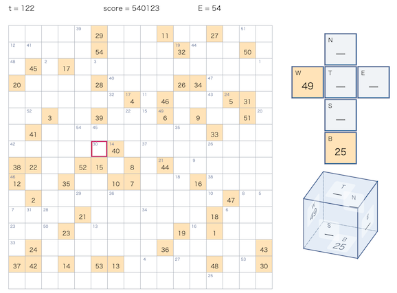

# AHC GenAI Rules Trial Contest 2026

[TOC]

## 問題概要

- https://atcoder.jp/contests/ahc_genai_test_2026
- N\*N マスの盤面があり、1つのサイコロと、M個の荷物と各荷物に対応する目的地が存在している
  - 各マスには荷物を高々1つ置くことができる
- サイコロの各面には荷物を高々1つ保持することができ、サイコロを転がすと、移動後に、サイコロの底面とマスの荷物を交換する、という動きができる
  - 片方が空の場合は、荷物を片方に移動するような動きになる
  - どちらも空なら何もおきない
  - 交換は必ず行われる
- できるだけ多くの荷物を、できるだけ少ない操作回数で目的地へ運べるような操作列を求めよ

## 時間

- 72 時間

## 個人的メモ

- 突然始まった生成AI利用ルール評価の試験コンテスト(unrated)
  - 指定プロンプトによる挙動の影響とか使い心地を検証するのが目的

### サイコロ運搬についての考察

- 最終的にはあまり本質ではなかったかもだけど、サイコロ運搬についてのいくつか考察がある

#### 目的地までの操作手数

- 「サイコロで運ぶ」だと、単純なマンハッタン距離と少し違いがある
  - 目的地マスの4近傍隣接マスの場合は、マンハッタン距離は1だけど、拾って(そのマスでサイコロの底面に保持してから)荷物を運ぶ場合は3手かかる
  - 目的地マスの斜めの位置のマスの場合は、マンハッタン距離は2だけど、6手もかかる
  - 目的地との距離だけでなく、サイコロのどの面で保持しているかでも手数に違いがある
  - 手数自体は、目的地に置いた状態から逆向きにBFSすれば求められる
    - 他の荷物を考えない手数であれば、事前計算しておける
- (試してみると、荷物を拾ってから置くまでの最短手数での経路数は、制約が多いためか、そんなに多くないみたい)

#### 保持して直線長距離移動

- サイコロの側面に荷物を保持すると、その面を側面に維持する上下または左右の方向には、その荷物を途中に置かずに保持したまま移動することができる
  - https://x.com/uta_cccc/status/2111778171658109260
  - https://x.com/G4NP0N/status/2111783390693425271

#### 盤面の状態を壊さずに移動

- マスx、a、bの順番に移動する場合、x -> a -> b -> a -> bのように戻るような操作をすると、\+2手でマスaとマスbの荷物を動かさずにサイコロを移動させることができる
- 似たように、進んだ経路を戻るような感じに動くと、途中の状態を戻すことができる

### アプローチ

#### 1手ずつビムサ

- 単純に、各荷物の目的地までの運搬手数を評価関数として1手ずつビムサ、みたいなのものでも動いて、しかもかなり手数が少ない解を見つけられる
  - 明示的に荷物を目的地まで運ぶようなマクロ操作をしなくてもよい
  - (ただし、Diceの位置別でビームを持つ的な多様性確保か、ビーム幅をかなり大きくとる、とかが必要だったかも)
    - [AHC011](./ahc011.md)の「空マス位置で区別して多様性確保」相当のやつ
- 荷物の運び残しへの対処
  - 未解決の荷物・目的地の位置の分散を評価に入れるとよいみたい
    - https://x.com/Rafbill_pc/status/2111764959264960521
    - [AHC063](./ahc063.md)
  - (自分はバウンディングボックス面積でやってしてしまったけど、サイズが変わるためにはその辺がすべて処理しきれないと減らず、離散的でよくなかった、、、)

#### その他のビムサ

- n手先までを候補化するビムサ
  - https://x.com/uta_cccc/status/2111771071708004578
- 荷物を1つずつ運ぶビムサ
  - 荷物を1つずつ揃えていく(マクロ操作)ビムサ
  - 荷物を拾いに行くところと、拾った荷物を運ぶ部分の経路に自由度があるので、できるだけ移動後の盤面状態がよくなるようにすると全体手数が減ったりする
  - けど、この方針だと、1手ずつビムサほどは手数が減らせなかった、、、

### その他

#### サイコロを使った似たようなゲーム

- XI
  - [wikipedia](https://ja.wikipedia.org/wiki/XI_(%E3%82%B2%E3%83%BC%E3%83%A0))
  - これは同じ数字の面をつなげるゲーム

## 解説

(50位まで&発言を見つけられた方のみ)

- [writerコメント](https://x.com/wata_orz/status/2111759368920396074)
  - https://x.com/wata_orz/status/2112062422764937538
  - https://x.com/wata_orz/status/2112063436746354809
  - https://x.com/wata_orz/status/2112067892623843552
  - https://x.com/wata_orz/status/2112138072301383836

- [Rafbillさん](https://x.com/Rafbill_pc/status/2111764956085457292)
- [G4NP0Nさん](https://x.com/G4NP0N/status/2111761236438524376)
  - https://x.com/G4NP0N/status/2111761768053895478
  - https://x.com/G4NP0N/status/2111762747474264490
  - https://x.com/G4NP0N/status/2111765914786079024
  - https://x.com/G4NP0N/status/2111774578460811752
  - https://x.com/G4NP0N/status/2111783390693425271
- [Shun_PIさん](https://x.com/Shun___PI/status/2111997046140084546)
- [MathGorillaさん](https://x.com/MathGorilla_cp/status/2111759636990923166)
  - https://x.com/MathGorilla_cp/status/2111762417244086574
  - https://x.com/MathGorilla_cp/status/2111763180641026513
  - https://x.com/MathGorilla_cp/status/2111795572445528485
- [PrussianBlueさん](https://x.com/prussian_coder/status/2111762169662730288)
  - https://x.com/prussian_coder/status/2111765637207117951
  - https://x.com/prussian_coder/status/2111798384990544089
- [terry_u16さん](https://x.com/terry_u16/status/2111812673646235911)
  - https://x.com/terry_u16/status/2111813476440281136
- [k1suxuさん](https://x.com/k1suxu/status/2112059984955715800)
  - https://x.com/k1suxu/status/2112066608625811967
- [kariaaさん](https://x.com/kaliafluorido/status/2111760798884430157)
- [occhanさん](https://x.com/occhan_code/status/2111781854428934384)
  - https://x.com/occhan_code/status/2111762767409795535
- [keroruさん](https://x.com/keroru10/status/2111780388297421017)
  - https://x.com/keroru10/status/2111781689483788766
  - https://x.com/keroru10/status/2111819297886818360
- [mtmr_s1さん](https://x.com/mtmr_s1/status/2111846948730982807)
- [uta_cccさん](https://x.com/uta_cccc/status/2111771071708004578)
  - https://x.com/uta_cccc/status/2111771356455186570
  - https://x.com/uta_cccc/status/2111778171658109260
- [Kiri8128さん](https://x.com/kiri8128/status/2111776004813566382)
- [gurukunさん](https://x.com/gurukun41/status/2111865144531927262)
- [tyokousagiさん](https://x.com/tyokousagi25/status/2111775682351321484)
  - https://x.com/tyokousagi25/status/2111777511009087671
- [ozy4dmさん](https://x.com/ozy4dm/status/2111820391320784990)

## Links

- [twitter hashtag AHC_GenAI26](https://x.com/hashtag/AHC_GenAI26)
- [twitter search AHC_GenAI26](https://x.com/search?q=AHC_GenAI26)
